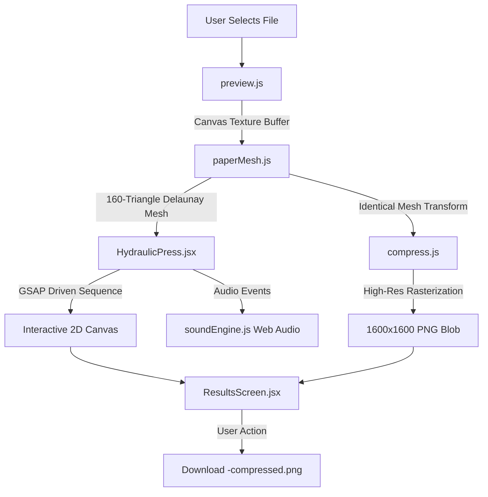

# 🗜️ CRUSHR

> **Make your files smaller. Literally.**  
> *A satirical, in-browser physical file compressor that takes your uploaded files, renders their real contents onto a subdivided geometric paper sheet, crushes them into a mangled paper ball with a heavy-duty hydraulic press, and exports the result as a downloadable 1600 × 1600 PNG.*

[](https://opensource.org/licenses/MIT)
[](https://react.dev/)
[](https://vitejs.dev/)
[](https://greensock.com/gsap/)
[](https://mozilla.github.io/pdf.js/)
[](https://playwright.dev/)

---

## 📖 About the Project

**CRUSHR** is a comedic take on file compression utilities. Traditional file compressors optimize binary payloads, discard redundant bytes, or run dictionary compression. **CRUSHR takes the term "file compression" literally**:

1. You upload a document, photo, or code file.
2. The browser renders the real visual content of your file onto a crisp 2D paper sheet.
3. A seeded, connected **160-triangle geometric mesh** simulates real mechanical crumpling, buckling, and fold creasing.
4. An industrial **hydraulic press** sequence runs in real-time, accompanied by procedural Web Audio mechanical squeaks, air hisses, and heavy sub-bass crunch impacts.
5. The exact deformed mesh is baked onto a high-resolution **1600 × 1600 export canvas** and provided as an instant PNG download (`<filename>-compressed.png`).

> [!NOTE]  
> **CRUSHR is an intentional novelty / physical compression joke.**  
> It does not reduce the binary size of your original file or output a `.zip` archive. It literally squashes your file into a crushed piece of crumpled paper.

---

## ⚡ Core Features

- **Real Document Rendering**: Extracts and displays actual file content:
  - **PDFs**: Page 1 rasterized at high resolution via a bundled, local PDF.js Web Worker.
  - **Images (PNG, JPEG, WebP)**: Full-resolution image drawn onto the victim paper.
  - **Plain Text / Code (TXT, LOG, MD)**: Text excerpt line-wrapped onto ruled paper.
  - **Other Formats (Office, Archives, etc.)**: Formatted industrial manifest card displaying the real filename, extension, and detected size.
- **Geometric Paper Crumple Physics**: 160 connected triangles with non-linear displacement, interior vertex buckling, overlapping edge folds, and directional crease shading calculated from normal vectors.
- **7.35-Second Choreographed Sequence**:
  - *Feed (0.0s – 1.0s)*: Sheet feeds onto the hydraulic anvil bed.
  - *Descent & Contact (1.0s – 3.2s)*: Steel press plate descends until contact is made.
  - *Slow Squeeze & Buckle (3.2s – 4.7s)*: Paper visibly crinkles and bulges as pressure rises on the analog dial.
  - *Hesitation & Slam (4.7s – 5.2s)*: Needle quivers under extreme load, machine shakes, and violently slams down with particle dust bursts.
  - *Retraction (5.2s – 6.5s)*: Ram lifts to reveal the permanently flattened paper ball.
  - *Tray Drop & Delivery (6.5s – 7.35s)*: Mechanical tray drops the crumpled wafer into the delivery chute.
- **Procedural Web Audio Engine**: Zero external MP3/WAV assets. Synthesizes bandpass-filtered pneumatic hiss, sub-bass oscillator thuds, and metallic crunch impacts in real-time with an instant mute toggle.
- **Pixel-Identical 1600 × 1600 PNG Export**: The downloaded image is generated from the identical vertex transformation and light vectors used in the animation.
- **100% Client-Side Privacy**: All processing runs in local browser memory. Files never leave your device.
- **Full Accessibility**: Respects `prefers-reduced-motion` with an accessible 450 ms transition directly to the result.

---

## 📋 Format Support & Constraints

| File Type | Preview Method | Handling Details |
|---|---|---|
| **PDF (`.pdf`)** | Mozilla PDF.js v5 | Renders page 1 at 2× resolution. Encrypted / password-protected files prompt for an unlocked copy. |
| **Images (`.png`, `.jpg`, `.jpeg`, `.webp`)** | HTML5 Canvas / ImageBitmap | Fitted to canvas maintaining natural aspect ratio. |
| **Text (`.txt`, `.log`, `.md`)** | Canvas Typography Engine | Line-wrapped text block with truncation indicators. |
| **All Other Files (`.docx`, `.xlsx`, `.zip`, etc.)** | File Manifest Card | Authentic technical card displaying filename, detected MIME type, and size. |

### Operational Limits
- **Max File Size**: 20 MB ceiling.
- **Max Image Resolution**: 40 megapixels decode limit to protect browser memory.
- **Preview Resolution**: Clamped to 1400px maximum dimension.
- **Timeout Protection**: 6-second watchdog timer cancels hung decoders automatically.

---

## 🏗️ Architecture & Pipeline



### Flow State Machine (`App.jsx`)
```
idle ──> preparing ──> ready ──> compressing ──> complete
  │          │           │            │             │
  └──[Error Recovery]────┴────────────┴─────────────┘
```
- **Generation IDs & AbortController**: Eliminates race conditions when files are changed or cancelled mid-process.
- **Memory Management**: Generated Object URLs are tracked and explicitly revoked on component unmount or reset.

---

## 🚀 Getting Started

### Prerequisites
- **Node.js**: `20.19+` or `22.12+`
- **npm**: `10+`

### Installation

```bash
# Clone the repository
git clone https://github.com/Anandakrishnan-VP/file-compressor.git
cd file-compressor

# Install dependencies (automatically runs predev to vendor PDF.js assets)
npm install
```

### Running Locally

```bash
# Start Vite development server
npm run dev
```
Open **`http://localhost:5173`** in your browser.

> [!TIP]
> The `predev` and `prebuild` scripts execute `scripts/copy-pdf-assets.mjs`, which copies PDF.js worker files, CMaps, and standard fonts into `public/pdf-assets/`. This guarantees full offline PDF rendering without external CDN calls.

### Production Build & Preview

```bash
# Compile optimized bundle
npm run build

# Preview production build locally
npm run preview -- --host 127.0.0.1 --port 5173
```

---

## 🧪 Automated Testing

CRUSHR includes an automated test suite powered by **Playwright**:

```bash
# Install Playwright browser binary
npx playwright install chromium

# Execute test suite
npm test
```

### Verified Test Cases
- ✅ Accurate PDF page 1 extraction via worker.
- ✅ Correct handling of encrypted/locked PDFs (`tests/fixtures/locked.pdf`).
- ✅ Image decoding and aspect-ratio preservation across PNG, JPEG, and WebP.
- ✅ Text excerpt wrapping, bounds checking, and overflow indicators.
- ✅ Byte-for-byte identity between canvas preview and downloaded PNG.
- ✅ 7.35-second GSAP timeline sequence and sound engine trigger sync.
- ✅ Live audio mute gain-node toggling and Web Audio context closure.
- ✅ Memory leak prevention and Object URL revocation.
- ✅ Rapid file swapping and cancellation via AbortController.
- ✅ Mobile viewport responsiveness down to 320px.
- ✅ Reduced motion accessibility compliance.

> To save screenshots and downloaded PNG artifacts during tests:
> ```bash
> export CRUSHR_EVIDENCE_DIR="./test-artifacts"
> npm test
> ```

---

## 🗂️ File Structure

```
file-compressor/
├── public/
│   └── pdf-assets/              # Locally vendored PDF.js worker, CMaps, fonts
├── scripts/
│   └── copy-pdf-assets.mjs      # Asset copy build hook
├── src/
│   ├── components/
│   │   ├── DropZone.jsx         # Upload area, drag-and-drop, sample file trigger
│   │   ├── StagePanel.jsx       # Animation chamber container
│   │   └── ResultsScreen.jsx    # Complete screen, visual comparison, PNG download
│   ├── scenes/
│   │   └── HydraulicPress.jsx   # Canvas-drawn hydraulic press & GSAP timeline
│   ├── utils/
│   │   ├── compress.js          # 1600x1600 final export canvas rasterizer
│   │   ├── paperMesh.js         # 160-triangle geometric deformation & shading
│   │   ├── preview.js           # Client-side texture generator (PDF/Image/Text)
│   │   └── soundEngine.js       # Procedural Web Audio API sound synthesizer
│   ├── App.jsx                  # Root state machine & layout
│   ├── index.css                # Stylesheet, theme tokens, and keyframes
│   └── main.jsx                 # Entry point
├── tests/
│   ├── app.spec.js              # Comprehensive Playwright test suite
│   ├── fixtures.js              # Test PDF and image buffer generators
│   └── fixtures/locked.pdf      # Password-protected test PDF
├── LICENSE                      # Full MIT License
├── package.json
└── vite.config.js
```

---

## 📄 License

This project is licensed under the **MIT License**.

```text
MIT License

Copyright (c) 2026 Anandakrishnan V P

Permission is hereby granted, free of charge, to any person obtaining a copy
of this software and associated documentation files (the "Software"), to deal
in the Software without restriction, including without limitation the rights
to use, copy, modify, merge, publish, distribute, sublicense, and/or sell
copies of the Software, and to permit persons to whom the Software is
furnished to do so, subject to the following conditions:

The above copyright notice and this permission notice shall be included in all
copies or substantial portions of the Software.

THE SOFTWARE IS PROVIDED "AS IS", WITHOUT WARRANTY OF ANY KIND, EXPRESS OR
IMPLIED, INCLUDING BUT NOT LIMITED TO THE WARRANTIES OF MERCHANTABILITY,
FITNESS FOR A PARTICULAR PURPOSE AND NONINFRINGEMENT. IN NO EVENT SHALL THE
AUTHORS OR COPYRIGHT HOLDERS BE LIABLE FOR ANY CLAIM, DAMAGES OR OTHER
LIABILITY, WHETHER IN AN ACTION OF CONTRACT, TORT OR OTHERWISE, ARISING FROM,
OUT OF OR IN CONNECTION WITH THE SOFTWARE OR THE USE OR OTHER DEALINGS IN THE
SOFTWARE.
```
